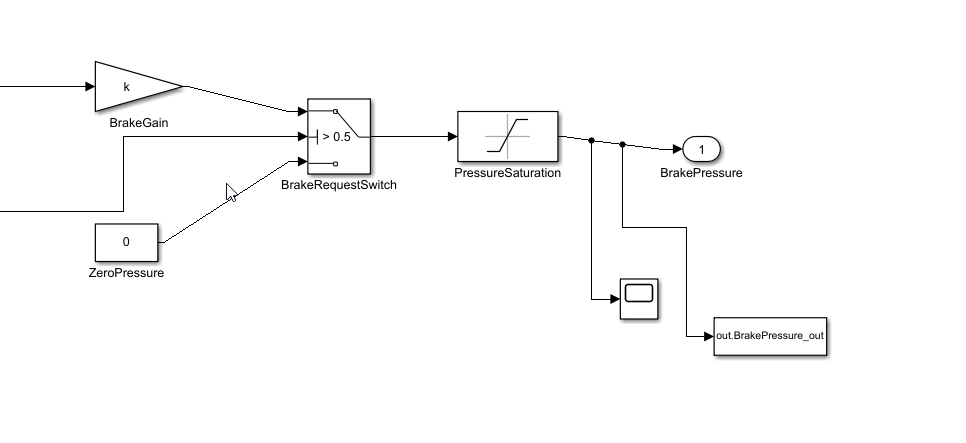

# AUTOSAR-Oriented Brake Controller

## Overview

A Simulink brake-controller example that demonstrates AUTOSAR-oriented modeling concepts, data-dictionary use and automated Model-in-the-Loop (MIL) test reporting.

## Included Files

- `Model/BrakeController_MBD.slx` — controller model
- `Model/BrakeController_Autosar.slx` — AUTOSAR-oriented model artifact
- `Parameters/BrakeController_Data.sldd` — Simulink data dictionary
- `Scripts/CreateBrakesystem.m` — model setup/configuration script
- `Scripts/Run_Automation.m` — test execution and report script

## Test Scenarios

The automation script defines four combinations of vehicle speed and brake request and compares the simulated brake-pressure output with expected values. The exact model logging configuration must match the script before running it.

## How to Run

1. Open MATLAB/Simulink.
2. Set the working directory to this project folder.
3. Check that the model path, data dictionary and logged output names in the scripts match the local setup.
4. Open the model and run `Scripts/Run_Automation.m`.
5. Inspect the displayed MIL report and pass/fail summary.

This is an AUTOSAR-oriented portfolio example; it should not be represented as a production-ready or certified AUTOSAR implementation.

## Screenshot

