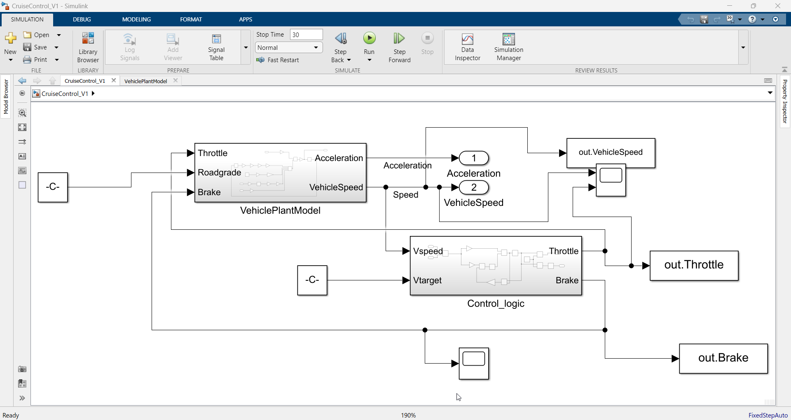
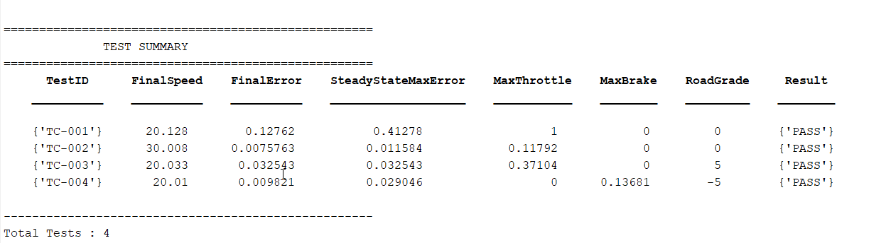

# Cruise Control — Model-Based Development

## Overview

MATLAB/Simulink cruise-control portfolio project illustrating a requirement-led controller development and verification workflow. The project includes a Simulink model, initialization parameters, requirement traceability workbook, test scripts and documentation.

## Workflow

```text
Requirements and traceability
            ↓
     Simulink model
            ↓
       MIL tests
            ↓
   Automated regression
            ↓
 C code generation / SIL workflow
```

## Included Scenarios

- Nominal speed tracking
- Throttle-limit checking
- Uphill driving scenario
- Downhill driving scenario

The test scripts record selected speed and actuator metrics and evaluate pass/fail criteria. Review the traceability workbook and individual scripts for the exact thresholds and assumptions.

## Folder Contents

- `Model/CruiseControl_V1.slx` — Simulink model
- `Parameters/CC_init.m` — initialization script
- `Requirements/CruiseControl_Requirements_Traceability.xlsx` — requirements and test traceability
- `TestCases/` — individual scenario scripts
- `Scripts/run_AllTests.m` — regression test runner
- `Documents/MBD_Documentation.md` — extended project documentation

## How to Run

1. Open MATLAB/Simulink and set this folder as the working directory.
2. Open `Model/CruiseControl_V1.slx`.
3. Run `run('Parameters/CC_init.m')` if required by the model.
4. Run `run('Scripts/run_AllTests.m')`.
5. Review the printed test summary and any generated results.

Use a compatible MATLAB/Simulink installation. Exact behavior depends on the model configuration and installed products. Do not describe MIL/SIL or code-generation results as verified unless you have run them successfully in your environment.

## Skills Demonstrated

Requirements traceability, discrete-time control, MIL testing, regression automation, C code-generation workflow and SIL concepts.


## Screenshots

**Simulink model**



**Automated regression test summary**


