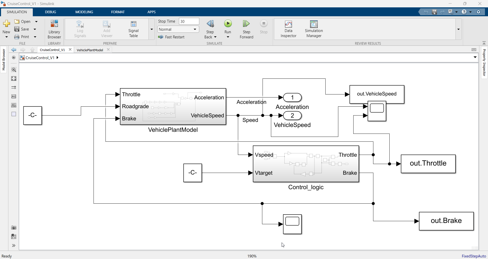
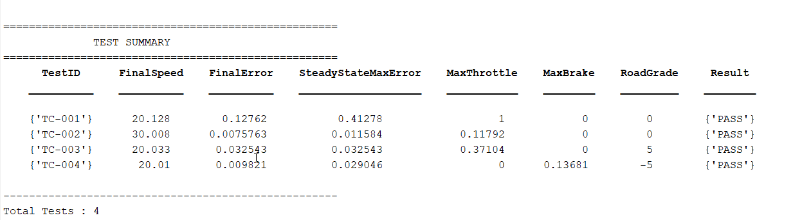
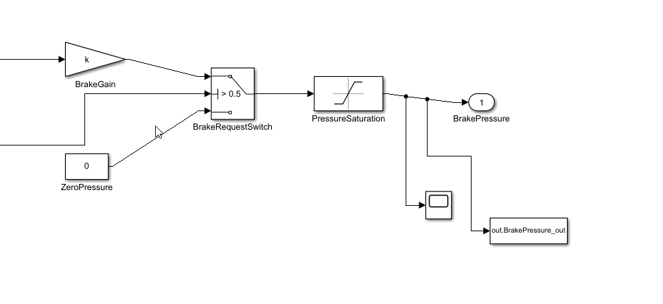

# Automotive MBD & Simulation Toolkit

A personal automotive engineering portfolio covering **Model-Based Development (MBD), MATLAB/Simulink, AUTOSAR-oriented modeling.**

The repository contains small, demonstrable projects intended to show engineering workflow, model verification, interface inspection, and repeatable reporting. The tools and models are portfolio examples—not production-certified automotive software.

## Projects

| Project | Main technologies | Demonstrates |
|---|---|---|
| [Cruise Control MBD](ModelBasedDevelopment/Cruise_Control/README.md) | MATLAB, Simulink | Requirements traceability, discrete control, MIL tests, regression workflow, code-generation/SIL workflow |
| [AUTOSAR Brake Controller](ModelBasedDevelopment/Autosar_Brakecontroller/README.md) | MATLAB, Simulink, AUTOSAR concepts | Controller model, data dictionary, fixed-step simulation and automated MIL test reporting |

## Repository Layout

```text
automotive-mbd-toolkit/
├── README.md
├── ModelBasedDevelopment/
│   ├── Cruise_Control/
│   │   ├── Model/
│   │   ├── Parameters/
│   │   ├── Requirements/
│   │   ├── TestCases/
│   │   ├── Scripts/
│   │   └── Documents/
│   └── Autosar_Brakecontroller/
│       ├── Model/
│       ├── Parameters/
│       └── Scripts/
└── docs/
    ├── README.md
    └── images/
```


### MATLAB/Simulink models

Open the relevant `.slx` model in MATLAB/Simulink and follow the project-specific instructions. The models may depend on MATLAB/Simulink releases and products available in your environment. The GitHub Actions workflow checks Python syntax only; it does **not** execute MATLAB/Simulink models or validate generated code.

## Engineering Workflow

```text
Requirements and interfaces
          |
          v
  Simulink controller model
          |
          v
  MIL simulation and tests
          |
          v
  Code generation / SIL workflow
```

## Evidence and Screenshots

The following screenshots are captured from the included project artifacts. More detail is available in each project README.

### Cruise Control





### AUTOSAR-Oriented Brake Controller



## Important Notes

- Example outputs are illustrative artifacts. Regenerate them from the included example inputs when possible.

## License

No license is included yet. Add one only after deciding how you want others to be allowed to use and redistribute this work.
